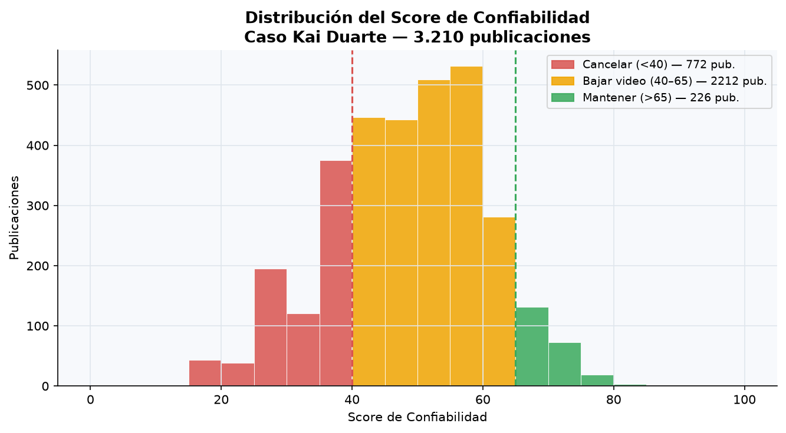
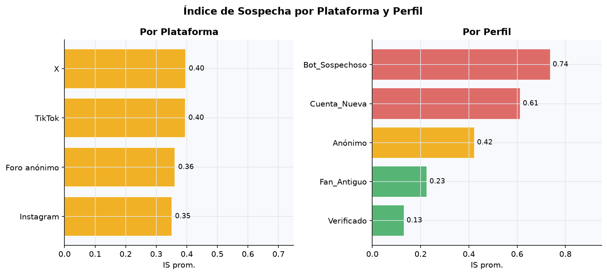
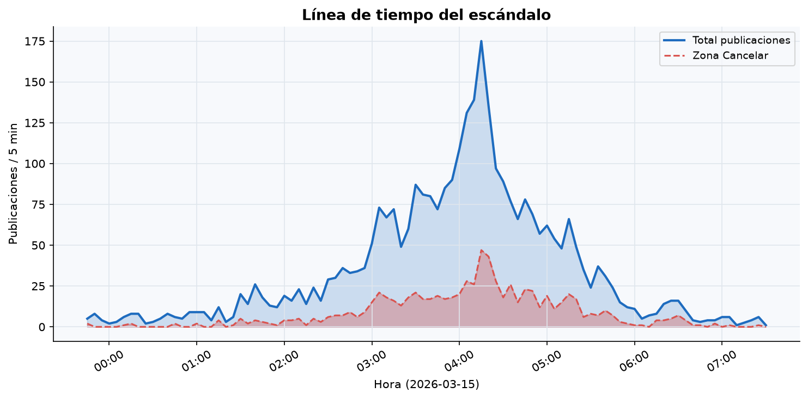
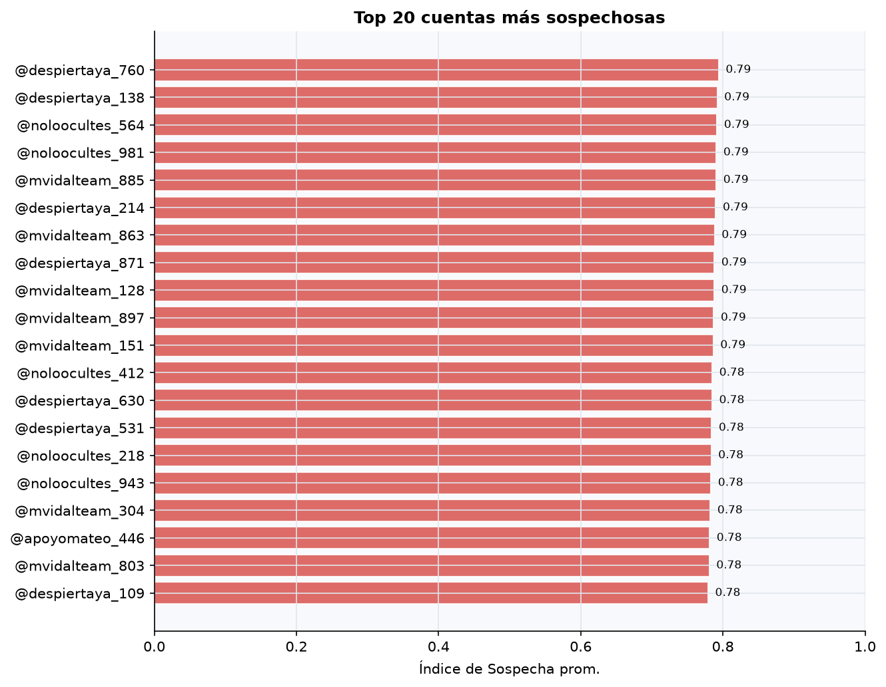

# Caso "Cancelado" — Análisis de Confiabilidad de Evidencia

**¿Qué tan real es un escándalo viral en redes sociales?**

Un clip de audio de 14 segundos con una voz que "suena a" el creador de contenido Kai Duarte
admitiendo amañar un sorteo millonario. En 40 minutos, 12.000 reposts. Tres marcas patrocinadoras
evalúan romper contratos. Seis horas después, aparecen "testigos", capturas y conversaciones —
una de ellas reciclada de un caso de hace 3 años.

**Misión:** separar la señal real del ruido fabricado y recomendar una acción:
**Cancelar · Bajar el video · Mantener**.

---

## Resultado

| Decisión | % de publicaciones |
|---|---|
| 🟡 **Bajar el video** ← **RECOMENDADO** | **68.3 %** |
| 🔴 Cancelar | 24.6 % |
| 🟢 Mantener | 7.1 % |

> La evidencia disponible no alcanza el umbral para una cancelación definitiva,
> pero hay señales suficientes de campaña orquestada para suspender el contenido
> mientras se realiza una verificación independiente.

---

## Hallazgos principales

- **25.9 % de las publicaciones** provienen de cuentas nuevas (<30 días) o bots sospechosos.
- La publicación detonante es una *Transcripción de audio/video* desde una cuenta anónima de
  **3 días de antigüedad** — el tipo de evidencia con menor verificabilidad del dataset.
- **190 publicaciones (5.9 %)** usan material idéntico o muy similar a un caso de 2023 con
  nombres cambiados — patrón clásico de desinformación fabricada.
- **Score de Confiabilidad promedio = 48.5 / 100** (zona amarilla): la evidencia no es
  suficientemente sólida para ninguna acción extrema.
- El clustering K-Means identifica **3 grupos naturales**: alta sospecha (bots coordinados),
  sospecha media (comentarios anónimos) y baja sospecha (cuentas verificadas / fans antiguos).
- Pico de actividad: **00:02 AM** — 84 publicaciones en un bloque de 5 minutos.

---

## Variables derivadas y fórmulas

### `Indice_Sospecha` (0–1)

```
IS = 0.30 × perfil_score
   + 0.25 × antigüedad_inv            # max(0, 1 − días/365) → cuentas nuevas = 1.0
   + 0.25 × velocidad_percentil       # rango percentil de Velocidad_Viralizacion
   + 0.20 × reciclado_score           # No=0, Posible=0.5, Sí idéntico=1.0
```

| Perfil | perfil_score |
|---|---|
| Bot_Sospechoso | 1.0 |
| Cuenta_Nueva | 0.8 |
| Anónimo | 0.6 |
| Fan_Antiguo | 0.2 |
| Verificado | 0.0 |

---

### `Tasa_Coordinacion` (0–1)

```
TC = % de publicaciones sospechosas (Bot/Nueva/Anónimo)
     en una ventana temporal ±15 min alrededor de cada publicación
```

---

### `Peso_Prueba` (0–1)

```
PP = tipo_base
   + min(0.20, Corroboraciones_Independientes × 0.04)
   − penalización_reciclado

tipo_base: Post original=0.80, Comentario=0.50, Repost/Cita=0.40,
           Desc. captura=0.30, Transcripción A/V=0.20
```

---

### `Score_Confiabilidad` (0–100)

```
SC = 40 × (1 − IS)         # confiabilidad del perfil / comportamiento
   + 35 ×  PP              # calidad de la evidencia
   + 15 × (1 − TC)         # ausencia de coordinación sospechosa
   + 10 × min(Corrobora/7, 1)  # respaldo de fuentes independientes
```

**Umbrales de decisión:**
- Score < 40 → `Cancelar`
- 40 ≤ Score ≤ 65 → `Bajar el video`
- Score > 65 → `Mantener`

---

## Visualizaciones

| Score de Confiabilidad | Sospecha por plataforma/perfil |
|---|---|
|  |  |

| Línea de tiempo | Top cuentas sospechosas |
|---|---|
|  |  |

---

## Estructura del proyecto

```
reto/
├── analisis_reto.ipynb       # Notebook principal (EDA + features + clustering + viz)
├── dashboard.html            # Dashboard autocontenido (abre directo en navegador)
├── requirements.txt          # Dependencias Python
├── data/
│   └── BASE.csv              # Dataset sintético (3.210 registros, 17 columnas)
├── src/
│   └── features.py           # Funciones de ingeniería de features (fórmulas documentadas)
├── outputs/
│   ├── resultados.json       # Resultados del análisis (consumido por el dashboard)
│   └── figuras/              # Gráficas PNG (4 figuras clave)
└── docs/
    ├── RETO.pdf              # Enunciado original
    ├── CANCELADO.pdf         # Descripción del caso
    └── GUIA_SOLUCION_RETO_CANCELADO.pdf
```

---

## Demo en vivo

**[Ver dashboard →](https://andrespadgu.github.io/deteccion-desinformacion/dashboard.html)**

---

## Cómo reproducir

```bash
# 1. Clonar el repositorio
git clone https://github.com/Andrespadgu/deteccion-desinformacion.git
cd deteccion-desinformacion

# 2. Instalar dependencias
pip install -r requirements.txt

# 3. Ejecutar el notebook (genera figuras y resultados.json)
jupyter notebook analisis_reto.ipynb

# 4. Abrir el dashboard (doble clic en el archivo o con un servidor local)
#    Opción A: doble clic en dashboard.html (funciona con datos embebidos)
#    Opción B: servidor local para que lea el JSON dinámicamente:
python -m http.server 8080
# → Abrir http://localhost:8080/dashboard.html
```

---

## Dataset

Los datos son **completamente sintéticos**, generados para este reto académico. No hay personas
reales involucradas. El dataset puede publicarse libremente.

| Columna | Tipo | Descripción |
|---|---|---|
| `ID_Publicacion` | int | Identificador único |
| `Plataforma` | cat | X / TikTok / Instagram / Foro anónimo |
| `Tipo_Publicacion` | cat | Post original / Comentario / Repost-Cita / Desc. captura / Trans. A/V |
| `Perfil_Usuario` | cat | Verificado / Fan_Antiguo / Anónimo / Cuenta_Nueva / Bot_Sospechoso |
| `Antiguedad_Cuenta_Dias` | float | Días desde la creación de la cuenta |
| `Velocidad_Viralizacion` | float | Reposts / hora en el período de análisis |
| `Contenido_Reciclado` | cat | No / Posible / Sí (idéntico a 2023) |
| `Corroboraciones_Independientes` | int | Fuentes independientes que corroboran |

---

## Tecnologías

- **Python 3.12** — análisis y features (`pandas`, `numpy`, `scikit-learn`, `matplotlib`)
- **Jupyter Notebook** — análisis reproducible
- **Chart.js 4.4** (CDN) — visualizaciones interactivas en el dashboard
- **HTML/CSS/JS** — dashboard autocontenido, funciona en GitHub Pages sin backend
- _Supabase Analytics_ — integración simulada con estética en el dashboard

---

> **Nota:** Reto académico del Capítulo Estudiantil DSAA — Data Science e Inteligencia Artificial.
> Datos sintéticos con fines educativos exclusivamente.
